

I build **local-first AI systems**: an inference engine for mixture-of-experts models on NVIDIA Blackwell GPUs, the agent harness that runs on it, voice and avatar pipelines, and a set of tools around them. Much of it runs on your own machine, and many projects are built to be driven by AI agents (through MCP, skills or a local API).

**Start here:** [TaDaMoo](https://github.com/nuspy/tadamoo), the harness and its engine · website: [tadamoo.com](https://tadamoo.com)

Each card links to its repository. Open **Details** under a card for what it does, its main features, the stack and what is worth noticing, including the limits the project states about itself.

<a href="https://github.com/nuspy/tadamoo">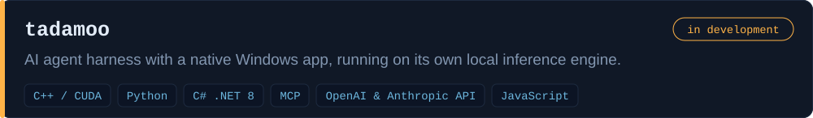</a>

<b>Details</b>

TaDaMoo is a harness for AI agents (chat, planner, cron jobs, skills, MCP, memory) with a native Windows app. It runs on Basalt-Plus, a local engine for the Qwen3.8-Flash-Next mixture-of-experts model on NVIDIA Blackwell GPUs, and on a second engine (Strata) for other hardware.

**Main features**
- A Loader that predicts memory and speed before loading a model, and a wizard that finds the best values for each PC.
- Plans as graphs and cron jobs that deliver to conversations or plans; conversations can message and spawn each other.
- A different provider per internal function: the loaded model, LM Studio, vLLM, llama.cpp, cloud services or any OpenAI-compatible server.
- Voice, avatars, meetings and telephony; encrypted wallet and personal memory; permission levels per channel.

**Notable**
- Prompt-injection defences are a design priority (a Rule of Two gate before an action that reaches outside).
- Basalt-Plus is a fork of Basalt, itself a fork of Strata (MIT); the notices are kept. Benchmark figures are the maintainer's own runs.
- The README lists what is not proven yet: Strata on non-Blackwell GPUs, and the voice paths on real hardware.

**Stack:** C++ / CUDA, Python, C# .NET 8, MCP, OpenAI & Anthropic API, JavaScript

<a href="https://github.com/nuspy/llmswitch">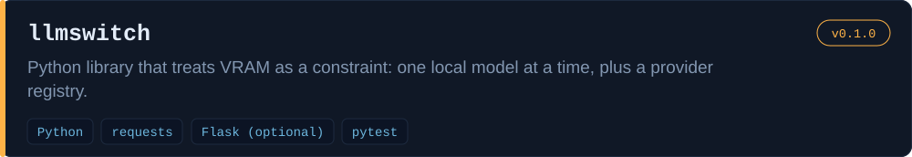</a>

<b>Details</b>

A model already loaded in memory is used as it is; one is loaded only if nothing is loaded and it fits in free VRAM. It also keeps a registry of providers (local, pay-per-use, subscription, CLI agents) and maps one reasoning-level vocabulary onto each provider's parameters.

**Main features**
- resolve() picks the loaded model across LM Studio and vLLM, waits for loads in progress and checks VRAM first.
- Reuse of official CLI logins with credential refresh, and CLI agents (Claude, Codex, Antigravity).
- A reasoning level from none to max, translated per provider dialect.

**Notable**
- Documents four traps of the LM Studio API and handles them by reading /api/v0/models.
- Refreshed credentials are written back atomically, with a backup the first time; tests never launch real CLIs or touch credentials.
- Used by AutoSkill and apisec-suite.

**Stack:** Python, requests, Flask (optional), pytest

<a href="https://github.com/nuspy/Differently-llm">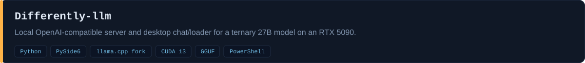</a>

<b>Details</b>

It wraps a patched llama.cpp build serving a ternary 27B model, with start and stop scripts and a native app with a chat and a server loader. A second engine option runs DiffusionGemma.

**Main features**
- An OpenAI-compatible endpoint for other apps on the network, with remote start and stop over SSH.
- A loader with the llama-server parameters: context, KV cache types, reasoning level, MTP, context shift.
- A chat with streaming, a collapsible reasoning panel, saved conversations and per-reply statistics.

**Notable**
- Source only: engines, CUDA runtime and weights are fetched separately, and the model file is checked against the published hash.
- The README warns that the model is uncensored and a moderation layer is needed for any user-facing use.

**Stack:** Python, PySide6, llama.cpp fork, CUDA 13, GGUF, PowerShell

<a href="https://github.com/nuspy/llama-diffusion">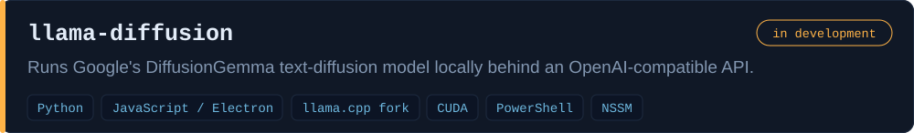</a>

<b>Details</b>

It builds a patched llama.cpp fork that can load the DiffusionGemma 26B-A4B model and serves it as /v1/chat/completions for agent frameworks. A patch caches the prompt KV so long prompts decode quickly, and an Electron chat window with a tray controller is included.

**Main features**
- OpenAI-compatible endpoints with just-in-time model loading and reasoning returned separately.
- Installer scripts that clone the engine, apply the patch, build with CUDA and download the model.
- An always-on Windows service or a GUI with a tray menu; per-message telemetry (tok/s, denoising steps).

**Notable**
- Its own patch caches the prompt KV in F16 and decodes only the canvas; the README gives measured speeds on an RTX 5090 (the author's own figures).
- The README tells an AI agent how to install the project and register only the provider.

**Stack:** Python, JavaScript / Electron, llama.cpp fork, CUDA, PowerShell, NSSM

<a href="https://github.com/nuspy/Openweight-Canary">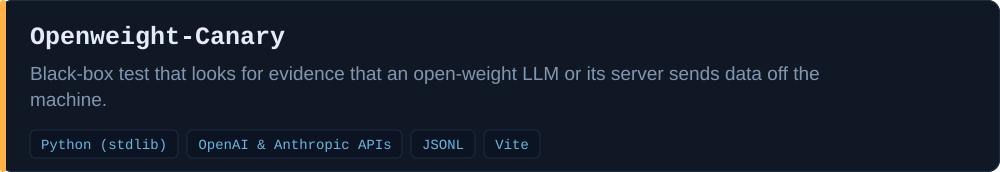</a>

<b>Details</b>

It plants fictional sensitive documents with unique canary strings, feeds each one, plus a matched control document, to the model through its HTTP API, and watches both the answers and the machine's network connections. Suspicious items go to a hash-chained findings log and a report.

**Main features**
- Long fictional documents in several domains, each with an unmarked control twin of the same length.
- Detection of canaries in answers, unprompted URLs and base64, network events and the sensitive-minus-control connection difference.
- Presets for llama.cpp, vLLM, SGLang, Ollama, LM Studio and others; an agent-harness mode with simulated tools.

**Notable**
- Every finding is appended to a hash chain, and `canary verify` fails on tampering.
- The reviewer model must differ from the model under test. The README says it produces evidence, never proof of absence.

**Stack:** Python (stdlib), OpenAI & Anthropic APIs, JSONL, Vite

<a href="https://github.com/nuspy/AutoSkill">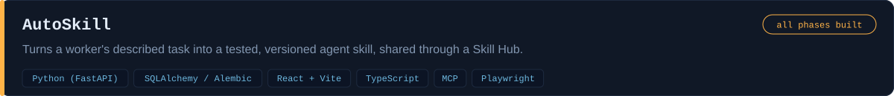</a>

<b>Details</b>

A non-technical worker explains a recurring task in an interview; the system drafts a SKILL.md, lets the worker try it step by step on their own agent, and publishes reviewed versions to a central hub. Failed runs feed an improvement loop where new versions need human authorization.

**Main features**
- A deterministic interview engine with ten completeness gates, one question per turn.
- Trials on the user's machine with preview, execute and verify checkpoints; irreversible steps are only simulated.
- A Skill Hub with visibility levels, search, updates and forks; an MCP server generated per skill version.

**Notable**
- Code owns the structure and the safety rules; the model only writes the content.
- Publishing and deprecating are human-only authorizations; API keys stay outside the repository and the database.

**Stack:** Python (FastAPI), SQLAlchemy / Alembic, React + Vite, TypeScript, MCP, Playwright

<a href="https://github.com/nuspy/AI-COOP">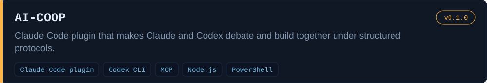</a>

<b>Details</b>

It adds two protocols as skills. /debate alternates analysis and adversarial critique until a reasoned consensus; /forge runs a full build cycle with a human-approved charter, a roadmap and a Codex-directed loop that Claude implements.

**Main features**
- A disagreement ledger and four attempts to unblock before escalating to the human.
- Forge phases: charter, roadmap, plan, implement, test, review, termination on real execution.
- A persistent Codex session across rounds; everything resumable.

**Notable**
- «Closed charter, open scope»: acceptance criteria change only by the human.
- The README admits Codex does not truly direct (Claude relays and executes) and that it is not yet validated on a full /forge cycle.

**Stack:** Claude Code plugin, Codex CLI, MCP, Node.js, PowerShell

<a href="https://github.com/nuspy/API-CLI">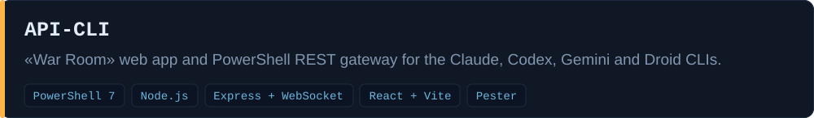</a>

<b>Details</b>

War Room is a web app where several CLI agents collaborate in a shared chat over rounds until they converge or you stop them, with a git checkpoint per round. PSLLMKit, a PowerShell module, exposes each CLI as an HTTP server or a direct call.

**Main features**
- A shared multi-agent chat with rounds and an undo of the last round.
- Start-LLMServer, Invoke-LLMPrompt, Register-CLITool and related commands.
- Per-server endpoints for prompt, status, session reset and health.

**Notable**
- Each CLI app runs as an independent server, and adapters, orchestrator and checkpoints are separate server modules.
- Needs the CLIs already installed and signed in.

**Stack:** PowerShell 7, Node.js, Express + WebSocket, React + Vite, Pester

<a href="https://github.com/nuspy/callAPIcall">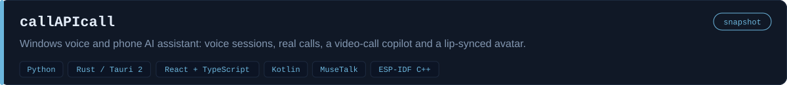</a>

<b>Details</b>

The Hermes agent, running natively on Windows, holds voice conversations, makes and takes mobile calls through a USB GSM modem or an Android phone over Bluetooth, and assists in video calls. A Python bridge orchestrates speech, the agent and the avatar, and a Tauri Control Center runs everything with guided tests.

**Main features**
- Half-duplex and full-duplex voice with barge-in, push-to-talk and an Android app over Tailscale.
- A video-call copilot that listens and suggests replies, optionally speaking in a cloned voice or through an avatar.
- A MuseTalk lip-sync avatar on a virtual webcam, and ESP32-P4 terminal firmware.

**Notable**
- A split architecture (gateway as a service, push-to-talk in the user session, GUI as a tray task), each with a supervisor that restarts it.
- This repository is a snapshot published without personal data, credentials or recordings. It depends on hardware, and the README states no call-quality results.

**Stack:** Python, Rust / Tauri 2, React + TypeScript, Kotlin, MuseTalk, ESP-IDF C++

<a href="https://github.com/nuspy/A-I-UDIO">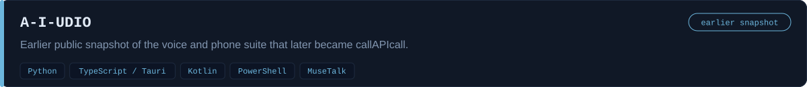</a>

<b>Details</b>

Its README describes the same Windows suite: a Hermes agent holding voice conversations, real mobile calls and video-call assistance with a lip-synced avatar. It still runs the agent in WSL, which callAPIcall later replaced with a native Windows setup.

**Main features**
- Half-duplex and full-duplex voice with barge-in.
- Real calls through a USB GSM modem or an Android phone over Bluetooth.
- Zero-shot voice cloning and a lip-synced avatar on a virtual webcam.

**Notable**
- Audio runs on the Windows host because WSL2 cannot see Bluetooth audio devices.
- Kept as history: see callAPIcall for the current version.

**Stack:** Python, TypeScript / Tauri, Kotlin, PowerShell, MuseTalk

<a href="https://github.com/nuspy/recordly-ai">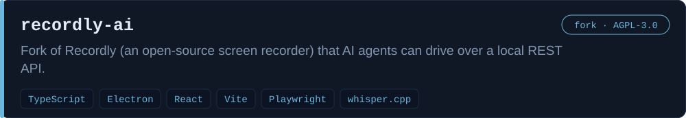</a>

<b>Details</b>

Upstream Recordly records and edits screen captures with auto-zooms and styled frames. This fork adds a loopback REST API and a headless server mode, so an agent can record, narrate, subtitle, edit and export software demos.

**Main features**
- A /v1 REST API with a bearer token, loopback only, with an OpenAPI document and live events.
- Live subtitles, narration, markers, zooms and blurs during a take, merged into the project on stop.
- Idle detection with automatic speed-up, speech-to-text through callAPIcall or whisper.cpp, and an agent skill.

**Notable**
- The fork touches upstream in few places so merges stay easy, and keeps the AGPL-3.0 licence; recording and editing are upstream's work.
- The recording clock excludes pauses and is the time base for everything an agent sends.

**Stack:** TypeScript, Electron, React, Vite, Playwright, whisper.cpp · upstream: [webadderallorg/Recordly](https://github.com/webadderallorg/Recordly)

<a href="https://github.com/nuspy/ltxstudio">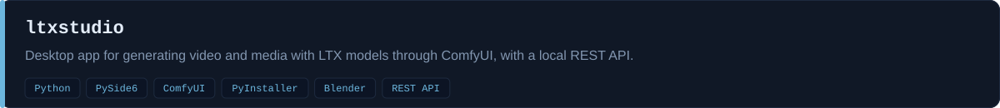</a>

<b>Details</b>

A desktop app with prompt and video settings, LoRAs with preview, live preview, an inpaint and outpaint canvas, and add-on tabs (image to video, reference-video control, audio, avatar, 3D). It exposes a REST API on 127.0.0.1 and agent packages for Hermes, OpenClaw, Claude Code, Antigravity and Codex.

**Main features**
- Text-to-video with LoRA, live preview and canvas editing.
- Add-ons for image-to-video, control, audio, avatar, swap, restore, 3D and LoRA training.
- A local REST API and agent packs with skills; PyInstaller packaging.

**Notable**
- A native backend with a ComfyUI compatibility layer and worker scripts per model family.
- Contains third-party material: some capabilities are rewritten from MIT projects (see NOTICE-openjutsu.md) and the Trellis folder holds third-party installer scripts. Models and outputs are not included.

**Stack:** Python, PySide6, ComfyUI, PyInstaller, Blender, REST API

<a href="https://github.com/nuspy/Mysterious-Languages">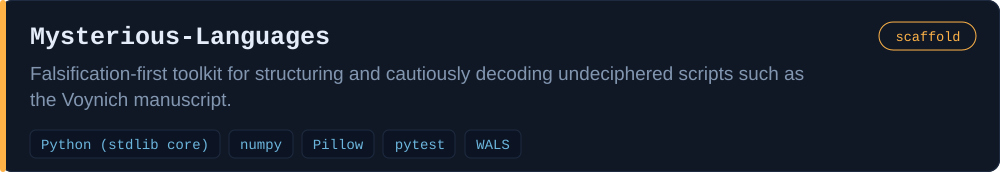</a>

<b>Details</b>

It goes from an image of an unknown script to ranked, falsifiable hypotheses: OCR into neutral symbols, statistical structure analysis, then typology-based candidate languages and cognate alignment. No hypothesis counts before it beats null models and a held-out test.

**Main features**
- OCR by segmentation and glyph clustering into private-use Unicode symbols.
- Structure analysis, including Currier A/B clustering of Voynich folios.
- Ranking against about 1,576 WALS language fingerprints and cognate alignment with learned sound correspondences.

**Notable**
- Half generation, half falsification: null models, positive controls and a false-solution detector. An isolate with no anchor yields «full structure, no meaning», and the README calls that the correct output.
- It does not decipher the Voynich manuscript. The LLM may only propose readings, never judge them.

**Stack:** Python (stdlib core), numpy, Pillow, pytest, WALS

<a href="https://github.com/nuspy/Drone-CV-Flight">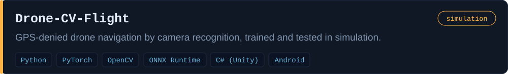</a>

<b>Details</b>

It estimates position, altitude, velocity and confidence from camera images, a mocked lidar altimeter and the clock, fusing several visual cues in an extended Kalman filter. One command runs capture, auto-sized training, a blind localization test, a target-reach test and a reliability report.

**Main features**
- Redundant cues: place recognition, absolute pose regression, visual odometry, sun and moon heading, lidar plus terrain prior.
- Environments built from open GIS data (elevation, buildings); a Unity package and an Android app.
- An automated blind test flight with an HTML and JSON pass/fail report.

**Notable**
- The simulator streams ground truth only to the test harness and refuses it to the localizer, so the test is blind by construction.
- Confidence calibration is a tested, reported metric. Simulation only: no real-drone flights are claimed.

**Stack:** Python, PyTorch, OpenCV, ONNX Runtime, C# (Unity), Android

<a href="https://github.com/nuspy/T-AI-rots">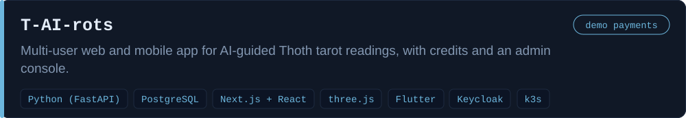</a>

<b>Details</b>

A user asks a question, answers a short AI interview, picks cards from a fan, sees each card revealed with its interpretation and gets a final synthesis that passes a guardrail. Backend, site, admin console, deployment files and a Flutter app are in the repository.

**Main features**
- A 78-card Thoth deck with doctrine, five spreads, and compatibility and couple readings.
- Credits, daily quota, invite codes, card of the day, journal and share links.
- An admin console with a model registry per task, and an interface in 15 languages.

**Notable**
- Stable-prefix prompt caching: role, guardrails and doctrine form an identical cached prefix, and only the reading data follows.
- The shuffle and cut are committed before the reveal and can be verified. Payments are simulated in this version, and each reading carries a disclaimer that tarot has no scientific basis.

**Stack:** Python (FastAPI), PostgreSQL, Next.js + React, three.js, Flutter, Keycloak, k3s

<a href="https://github.com/nuspy/Curriculum-AI">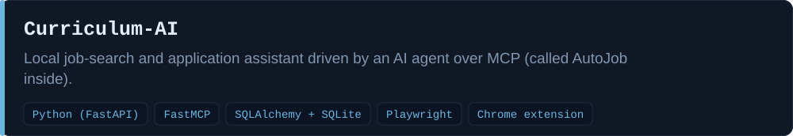</a>

<b>Details</b>

A local daemon searches job portals, ranks postings against a profile built from your CV and fills in application forms through a controllable browser. Submission is manual by default, so nothing is sent without your confirmation.

**Main features**
- A profile built from a CV with provenance, and it does not invent data.
- Multi-portal search, de-duplication and ranking with local embeddings.
- An MCP server, a dashboard and a Chrome extension; a queue for CAPTCHAs and missing data.

**Notable**
- Strict layering: the core services have no MCP or HTTP imports; the browser sits behind a driver port with fake, Playwright and extension drivers.
- CAPTCHAs are not bypassed, they go to the user. The README warns that large job portals forbid automation.

**Stack:** Python (FastAPI), FastMCP, SQLAlchemy + SQLite, Playwright, Chrome extension

<a href="https://github.com/nuspy/bookwriter">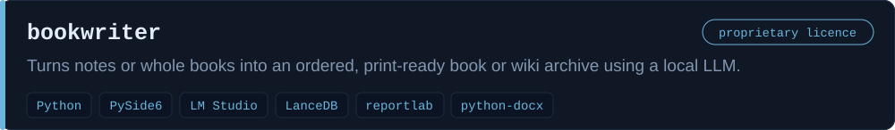</a>

<b>Details</b>

It ingests files, splits them into idea nodes and organizes them into chapters, then composes, rewrites, translates or writes a book from scratch through an interview. Output is PDF, DOCX, EPUB or Markdown, or a navigable HTML wiki with a graph.

**Main features**
- Four modes: compose, rewrite in a new style, translate, and Forge (interview-driven writing).
- A style engine that extracts, describes and blends authors with weights.
- One typesetter with real trim size, hyphenation and bibliography; a desktop GUI and a CLI.

**Notable**
- «Rule zero»: each chapter is written to disk as soon as it is drafted, and progress is read from the file system.
- It will not invent cover art or citations. The licence is proprietary and personal, not open source.

**Stack:** Python, PySide6, LM Studio, LanceDB, reportlab, python-docx

<a href="https://github.com/nuspy/wikibridge">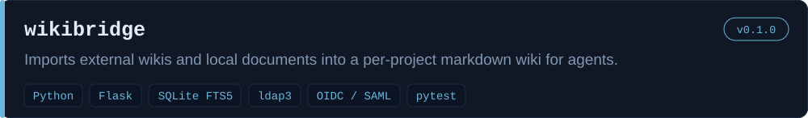</a>

<b>Details</b>

It crawls or reads MediaWiki, Confluence, Notion, HTML and local files (PDF, DOCX, PPTX, XLSX and others) into a project-isolated markdown wiki with full-text search and a knowledge graph. Agents, a GUI and a CLI can then use it.

**Main features**
- Resumable import by URL with incremental sync, and LLM cataloguing into entities, concepts and relations.
- Full-text search, a graph view, per-page history and a hash-verifiable audit log.
- LDAP and Active Directory login, OIDC and SAML single sign-on, per-document access control.

**Notable**
- Knowledge is isolated per project, and agents receive only the linked project's knowledge.
- The README states its limits: the crawler does not run JavaScript, and access control applies only to callers going through the API.

**Stack:** Python, Flask, SQLite FTS5, ldap3, OIDC / SAML, pytest

<a href="https://github.com/nuspy/apisec-suite">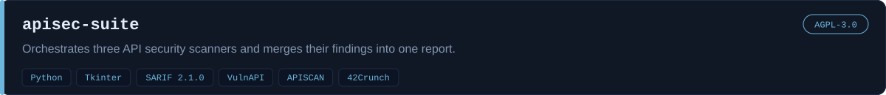</a>

<b>Details</b>

You configure the target and credentials once; the engines run in sequence, results are merged so the same flaw found by two engines becomes one finding, and a single report comes out in SARIF, JSON and HTML. An optional LLM analyses the merged findings.

**Main features**
- Runs VulnAPI and APISCAN locally and generates the CI workflow for 42Crunch.
- Cross-engine merge: on the included test target 68 raw findings became 54, with 7 confirmed by several engines.
- OpenAPI discovery and surface reconstruction when no spec exists; a GUI and a CLI.

**Notable**
- Engines run as separate processes, which keeps the licences apart. The LLM annotates but never deletes: a false-positive verdict only downgrades a finding to informational.
- Derived from APISCAN (Perry Mertens, AGPL-3.0), and the whole project is AGPL-3.0. The engines send real attack payloads: use them only on APIs you own or are authorized to test.

**Stack:** Python, Tkinter, SARIF 2.1.0, VulnAPI, APISCAN, 42Crunch · upstream: [perrym/apiscanner](https://github.com/perrym/apiscanner)

<a href="https://github.com/nuspy/lanterna">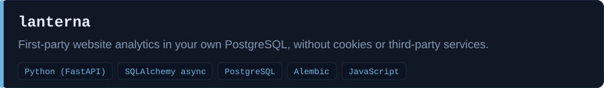</a>

<b>Details</b>

A browser observer and a FastAPI router collect page views, active time, scroll depth and declared clicks, and the server records business events. Visitors are counted with a daily salted hash instead of cookies.

**Main features**
- Cookie-free counting with sha256(salt, site, IP, user agent); the salt is destroyed after two days and the IP is never stored.
- An optional extended level only with consent, revocable.
- Channel classification from referrer and UTM, and local geolocation.

**Notable**
- Privacy by design: no cookie for the basic level, and the IP stays in memory only.
- Server events are recorded inside a SAVEPOINT so they never break the caller's transaction.

**Stack:** Python (FastAPI), SQLAlchemy async, PostgreSQL, Alembic, JavaScript

<a href="https://github.com/nuspy/seo-notify">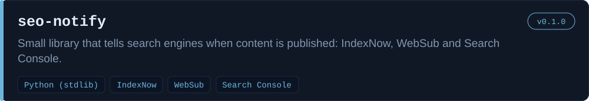</a>

<b>Details</b>

It sends URL notifications to IndexNow (Bing, Yandex, Naver, Seznam), pings a WebSub hub for feeds and submits sitemaps to Google Search Console with a service account. Written for the T-AI-rots site, reusable anywhere.

**Main features**
- An IndexNow client with key generation.
- WebSub hub notification for RSS and Atom feeds.
- Search Console sitemap submission as an optional extra.

**Notable**
- It deliberately does not use the Google Indexing API for ordinary content, which the README says is officially limited to job postings and broadcast events.
- IndexNow is written in-house because the protocol is a single JSON POST.

**Stack:** Python (stdlib), IndexNow, WebSub, Search Console

<a href="https://github.com/nuspy/VRAM_EXPLORER">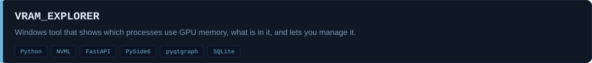</a>

<b>Details</b>

It reads Windows GPU performance counters and NVML to attribute video memory per process, queries AI backends (LM Studio, Ollama, ComfyUI, Automatic1111) to see what model each holds, and offers explicit actions such as unloading a model. The service itself only observes.

**Main features**
- Per-process dedicated, shared and committed memory, and a detector of spillover into system RAM.
- A planner that estimates whether a model fits and what to unload.
- History in SQLite with incident records, a GUI, a CLI and a local API.

**Notable**
- Destructive actions need an explicit confirmation and system processes are protected; the API is bound to loopback with a token.
- The README states its limits: no view of other processes' allocations under WDDM, and reservation is best-effort.

**Stack:** Python, NVML, FastAPI, PySide6, pyqtgraph, SQLite

<a href="https://github.com/nuspy/WordMD">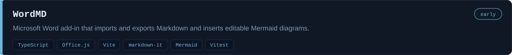</a>

<b>Details</b>

A task pane in Word with four tabs (Import, Style, Export, Diagram). It converts Markdown to Word using the document's styles or a chosen profile, and exports back to .md, .docx and .mdocx.

**Main features**
- Import from .md, a folder or pasted text, with profiles such as Word classic, GitHub and Business report.
- Mermaid blocks become diagrams; export keeps the Mermaid source editable in the .mdocx format.
- Footnotes, definition lists, highlight, subscript and superscript.

**Notable**
- Tests run a Markdown to Word to Markdown round trip over all elements.
- Early: it has not yet been verified inside a real Word instance.

**Stack:** TypeScript, Office.js, Vite, markdown-it, Mermaid, Vitest

<a href="https://github.com/nuspy/dithered_QR_Code">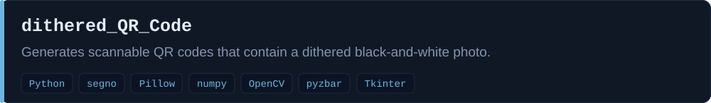</a>

<b>Details</b>

It builds a QR symbol where the unconstrained pixels of each module carry a dithered photo, keeps the functional patterns intact, then decodes the result again to measure readability and image fidelity. It runs as a command line tool, a desktop GUI and a local web page for iPhone and iPad.

**Main features**
- Three profiles (photo, balanced, robust) with different readability thresholds.
- Automatic tightening of parameters until the readability threshold passes.
- Installers for Windows, Linux, macOS and iOS (a-Shell).

**Notable**
- Constrained error-diffusion dithering: the forced pixels enter the diffusion as decided quantizations.
- Readability is measured with two software decoders over ten conditions; no phone-camera guarantee is stated.

**Stack:** Python, segno, Pillow, numpy, OpenCV, pyzbar, Tkinter

Only public projects are listed here. Figures quoted in a project's own README are that project's own measurements.

